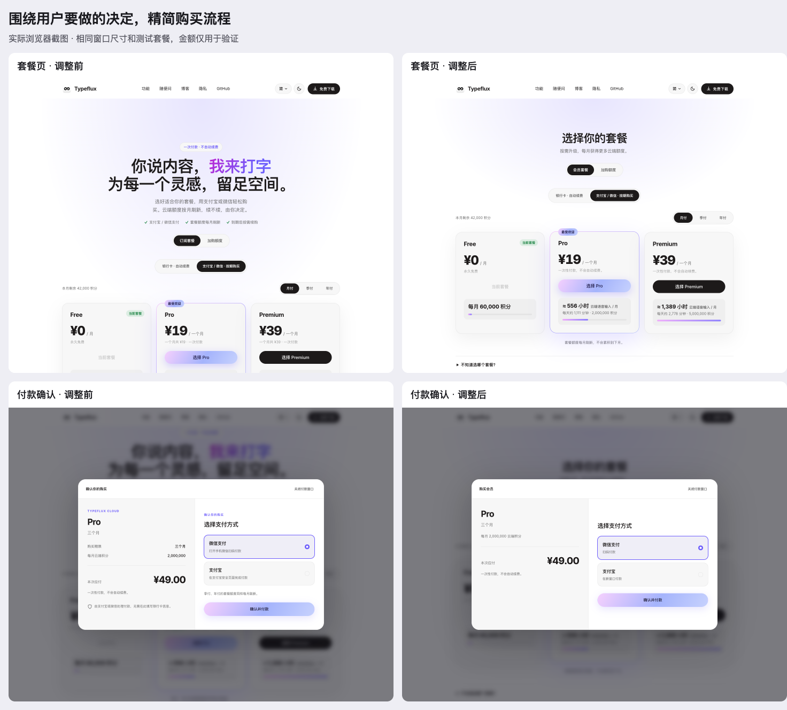

# GUL-420 customer content review

This pass reviews the prepaid plan page and purchase dialog after the first visual revision. The content rule is: show information when it helps the customer choose, authorize payment, or understand the outcome. Keep supplementary information available without making it compete with the purchase.

The before and after evidence was captured during this pass, with the same synthetic catalog, locale and desktop viewport. Amounts are fixtures, not proposed production pricing.

## Findings and resulting decisions

| Information | Customer need | Treatment |
| --- | --- | --- |
| Plan benefits, monthly allowance, term and full price | Understand what the purchase provides and costs | Keep visible; the headline uses the full term total. |
| One-time payment and no automatic renewal | Consent to how the purchase is billed | Keep on paid-plan cards and before payment, including a resumed unpaid order. |
| Monthly quota refresh and no rollover | Avoid assuming an annual purchase provides a year of credits immediately or accumulates unused credits | Keep one short sentence below the catalog; retain FAQ detail. |
| Marketing hero, repeated reassurance and provider-processing explanations | Do not help an existing app user complete this purchase | Replace with a compact plan-selection heading; remove repeated brand and security paragraphs. |
| Usage estimator and detailed plan comparison | Useful when unsure which plan fits, unnecessary after a plan is already chosen | Keep in a collapsed “Need help choosing?” section. Remove token-conversion and billing-formula explanations from this prepaid flow. |
| Order number and method record | Useful for support or receipts, unnecessary during a normal scan-and-pay flow | Put in collapsed order details; expand automatically for a payment requiring review. |
| Polling limits and authorization terminology | Describe internal mechanics instead of what to do | Use “I have paid,” “Check membership,” and “Reopen billing from Typeflux” as appropriate. |
| Duplicate-payment warning | Necessary when an earlier purchase is unresolved or payment has already been received | Show in those states, together with the corresponding recovery action. |
| WeChat on a phone | Native QR payment requires another device to scan the displayed code | State that limitation on narrow screens before confirmation and beside the QR. Do not imply this is an in-phone payment link. |
| Another-purchase prompt after success | Competes with the customer's next task and risks confusion after payment | Replace with Return to Typeflux; keep expiry visible once. |

## Flow evidence and health

1. **Choose a plan — clear in the captured state.** [Catalog](content-after/02-prepaid-desktop.png): a compact heading gives way to the full cards in the first desktop viewport. The allowance, price, period and non-renewal policy remain visible. [Optional help](content-after/14-optional-plan-help.png) still exposes the interactive estimator and comparison when requested.
2. **Confirm — clear in the captured state.** [Confirmation](content-after/06-order-confirmation.png): the plan, term, monthly allowance, full total and one-time policy are present once. Payment methods state the next action; no internal order reference or repeated “confirm purchase” headings compete.
3. **Pay — clear with fixture responses.** [Desktop](content-after/07-wechat-desktop.png), [mobile](content-after/08-wechat-mobile.png), [dark](content-after/09-wechat-dark.png), [Alipay](content-after/10-alipay-desktop.png): normal order details are folded. The payment action remains accessible; the WeChat phone limitation is explicit.
4. **Wait or resolve an issue — actionable in tested states.** [Activating](content-after/15-activating.png) distinguishes received money from membership activation. [Review](content-after/16-payment-review.png) gives an existing in-app Feedback route, opens the order reference and prevents another charge. Expired-page, recovery-failure and lost-response cases retain their safeguards.
5. **Finish — clear in the captured state.** [Success](content-after/11-membership-activated.png): one expiry, an order total instead of “total due,” and a Return to Typeflux action. No immediate repurchase prompt.

## Verification

- `npm run test:billing-coverage`: 328 tests pass across 21 files. Billing statements 96.01%, branches 93.46%, functions 98.40%, lines 97.81%.
- `npm run lint` and `npm run build`: pass, including 52 prerendered pages. The existing large-chunk advisory remains.
- Added checks for confirmation information, folded support references, review-specific disclosure, the successful app-return action, preserving expiry once, optional plan help, all supported copy locales, and unlimited balances.
- Browser checks covered desktop light/dark, English and Chinese phone layouts, widths 320/375/390/768, native disclosure controls, closing/resuming payment, separate Alipay navigation, and simulated paid/activation/review transitions.
- Focus containment includes the new native disclosure control. Existing Escape, focus restoration and scroll-lock tests pass. Screenshots alone do not establish complete accessibility compliance.

## Self-review and limits

Reviewed the full purchase path, visible information in each state, missing or unlimited quotas, unavailable terms, expired access, recovery failure, same-intent retry, terminal-order reset, polling cancellation, and receipt data exposure. The content changes preserve server confirmation as the source of payment and activation truth. Found and fixed the negative unlimited-balance display and kept the non-renewal policy visible when resuming an unpaid order.

All supported locale copy was updated. Visual inspection covers Chinese desktop/mobile/dark and English mobile. No real provider was charged, and operating-system handling of the existing Typeflux return link was not exercised.
