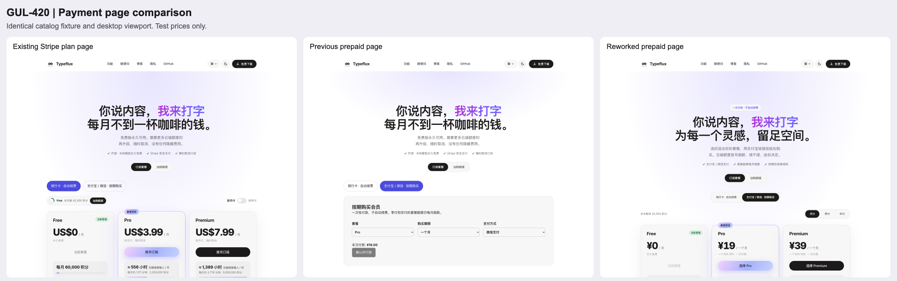

# GUL-420 payment UI review

The current implementation and screenshots are documented in the [customer content review](CONTENT_REVIEW.md). The evidence below records the earlier visual revision at `8c9b4e1`, before the content pass.

The previous prepaid view replaced the existing Stripe plan cards with three select fields and a generic button. It omitted plan benefits and retained Stripe/cancel-anytime claims in the hero. This revision uses the same plan-card component for both providers, followed by a dedicated order-confirmation and payment dialog.

## Captured evidence

All images are actual local Chrome screenshots. The before capture uses the merged implementation at `2353d9a`; after captures use this PR. Both use the same synthetic three-plan catalog, Chinese locale, and 1440 × 1100 desktop viewport. The Stripe reference is the existing Typeflux Stripe **plan page**, not Stripe's hosted checkout.

| Step | Before | After and health |
| --- | --- | --- |
| 1. Choose a plan | Benefits, quotas and plan hierarchy disappear on prepaid selection. Hero still says Stripe and cancel anytime. | Shared cards retain the existing hierarchy, featured plan, allowances, comparison and usage estimator. Prepaid copy describes one payment and monthly quota refresh. Healthy in captured states. |
| 2. Confirm the purchase | Three generic selects; no distinct confirmation step. | Term total, plan and method are shown before an order is created. Only configured terms/channels are purchasable. Healthy. |
| 3. Pay | Inline receipt and payment controls lack a clear visual hierarchy. | Two-column desktop checkout; compact stacked mobile summary. WeChat QR has a white quiet zone in both themes. Alipay opens a separate window while the status page remains. Healthy with synthetic provider responses. |
| 4. Recover or retry | Recovery errors could leave no visible guidance. | Recovery failures are visible and pause new charges. Dismissing resumes the same order. A lost creation response preserves the request ID and prevents changing the uncertain purchase. Healthy in automated cases. |
| 5. Finish | Status text shares the generic form container. | Payment received, entitlement granted, closed, review and refund are distinct. Activation includes the actual returned expiry. Review and pending orders cannot trigger another charge. Healthy in tested responses. |

## Screenshots

- Reference and original: [Stripe](before/01-stripe-reference.png), [prepaid desktop](before/02-prepaid-desktop.png), [prepaid mobile](before/03-prepaid-mobile.png), [prepaid dark](before/04-prepaid-dark.png).
- Revised catalog: [desktop](after/02-prepaid-desktop.png), [full plan cards](after/05-plan-cards.png), [mobile](after/03-prepaid-mobile.png), [dark](after/04-prepaid-dark.png).
- Revised payment: [confirmation](after/06-order-confirmation.png), [WeChat desktop](after/07-wechat-desktop.png), [390 × 844 mobile](after/08-wechat-mobile.png), [dark WeChat](after/09-wechat-dark.png), [Alipay](after/10-alipay-desktop.png), [activation](after/11-membership-activated.png), [375 × 640 scrolled state](after/12-wechat-small-mobile.png), [English mobile](after/13-english-checkout.png).

## Validation

Executed with Node 24.21.0 / npm 11.19.0:

- `npm run test:billing-coverage`: 323 tests pass across 21 files. Billing coverage: statements 96.02%, branches 93.31%, functions 98.40%, lines 97.82%.
- `npm run lint`: passes.
- `npm run build`: passes, including server build and 52 prerendered pages. The existing large-chunk advisory remains.
- Chrome exercises: plan selection → three-month confirmation → WeChat pending → entitlement granted; Alipay selection → separate window with no opener; dismiss → resume original order; English mobile confirmation; light and dark themes.
- No horizontal overflow at widths 320, 375, 390 and 768. At 390 × 844, amount, QR and payment actions fit together. Smaller heights scroll inside the dialog with the close control kept visible.
- Keyboard tests cover focus containment, Escape, returning focus to the original plan button and restoring body scroll.

## Self-review and limits

Reviewed the entry-to-result flow, unavailable terms, one-cent totals, current membership and renewal restrictions, failed recovery, lost responses, expired authorization, polling limits, request cancellation, payment-link storage, locale copy and Stripe regressions. Fixed silent recovery failure, uncertain-order selection changes and mobile controls falling out of view during this review. No credentials or real payment links appear in the evidence.

The catalog amounts are fixtures, not proposed pricing. Provider callbacks and payment settlement were simulated; no real charge was initiated. Real provider settlement remains outside this visual revision's local verification.
